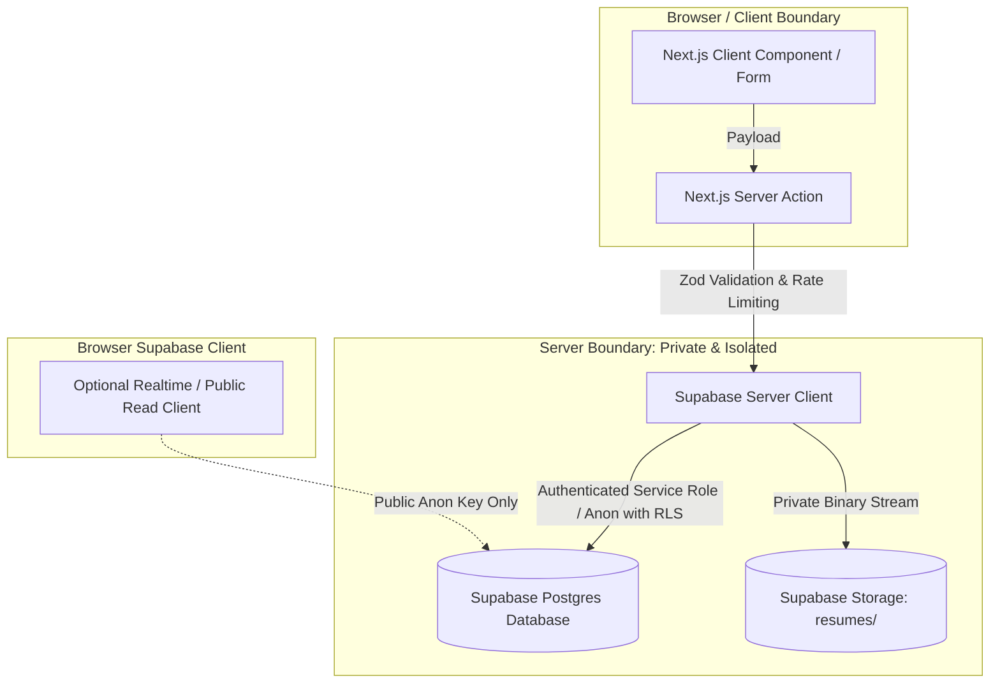

# Production-Grade Architecture Specification

## Current Solutions Implementation (October 5, 2026)

- Operating context uses `SolutionContextJourney`, an isolated client leaf with IntersectionObserver-driven step selection and native accessible buttons. Problem, Approach, and Outcome remain visible; a scoped CSS path traces between icon nodes. Observer cleanup and solution-key remounting prevent stale state across navigation. Reduced motion shows the full static path.

- `src/lib/solutions-data.ts` contains the four typed Solution records. `src/components/sections/solution-detail-experience.tsx` renders their shared detail-page narrative; `SOLUTIONS_NAV` supplies the current navigation and sitemap routes.
- Core capabilities use a title-keyed map of existing Lucide icons in the shared renderer, with five colored circular badges per page. Icons remain decorative (`aria-hidden`), with no new dependency, client state, or animation.
- Detail heroes reuse `SolutionsHeroShader`, have a `100svh` minimum height, and contain no photograph or duplicate contact CTA. The orange bottom CTA and previous/next navigation are absent. Existing shader and Reveal client leaves remain isolated.
- Delivery stages retain sequence numbers. Content, SEO, redirects, Services, authentication, analytics, and database behavior are unchanged by the icon refinement.

**Project:** Siddiona Technologies Services Pvt. Ltd. (`siddiona.com`)  
**Stack:** Next.js 16 (App Router, Server Components, React 19), Tailwind CSS v4, TypeScript 5, Supabase  
**Date:** 2026-08-31  
**Status:** Approved & Implemented Foundation  

---

## 1. Executive Architecture Overview

Siddiona.com is architected as a high-performance, accessible, and scalable enterprise web platform. The platform is designed from the ground up using **Next.js 16 App Router**, **React 19 Server Components**, **Tailwind CSS v4**, and **TypeScript** in strict mode, with a clean decoupling of UI presentation, business domain logic, and Supabase data operations.

```
D:\siddiona.com\
├── docs/                           # Architecture, Design System, Inventory & IA Specifications
├── public/                         # Static Assets (Logos, Partner Badges, Certifications)
├── src/
│   ├── app/                        # Next.js App Router (Layouts, Pages, Routes, Metadata)
│   ├── components/                 # UI Primitives, Sections & Layout Shells
│   │   ├── layout/                 # Header, Navigation, Footer, SkipToContent
│   │   ├── ui/                     # Container, Button, Badge, Card Primitives
│   │   ├── sections/               # Modular Page-Level Section Blocks
│   │   └── forms/                  # Interactive Zod-Validated Form Modules
│   ├── lib/                        # Shared Utilities, Supabase Clients, SEO Helpers
│   │   ├── supabase/               # Isolated Client & Server Supabase Factories
│   │   ├── seo/                    # Structured Data & OpenGraph Metadata Generators
│   │   ├── navigation.ts           # Centralized Navigation Taxonomy & Data
│   │   └── utils.ts                # Tailwind Class Merging & General Helpers
├── .gitignore                      # Production-Safe Git Exclusions
├── AGENTS.md                       # Next.js Agent Guidelines
├── eslint.config.mjs               # ESLint 9 Flat Config
├── next.config.ts                  # Next.js 16 Configuration
├── package.json                    # Project Manifest
├── postcss.config.mjs              # PostCSS / Tailwind CSS v4 Engine
├── PRODUCT.md                      # Canonical Product Truth & Constraints
├── skills-lock.json                # AI-Agent Skills Lockfile
└── tsconfig.json                   # Strict TypeScript Config
```

---

## 2. Server Components vs. Client Components

To ensure sub-second page loads and minimal client-side JavaScript execution, this codebase enforces a strict **Server Components First** paradigm:

1. **Server Components (Default):**
   - All page entries (`page.tsx`), root layouts (`layout.tsx`), marketing text sections, service catalog lists, and static layout wrappers are React Server Components.
   - Zero bundle weight transferred to the browser for static content and SEO metadata.
2. **Client Components (`'use client'` boundary):**
   - Restricted strictly to interactive leaves of the component tree:
     - Mobile navigation toggle drawers.
     - Interactive filter tabs (e.g. Career category filters, FAQ accordions).
     - Form handling with client-side Zod validation (`ContactForm`, `CareerApplicationForm`).
     - Animated interactive elements requiring browser event listeners.

---

## 3. Component Architecture & Organization

```
src/components/
├── layout/
│   ├── header.tsx              # Main navigation bar with desktop dropdowns
│   ├── mobile-nav.tsx          # Responsive mobile navigation drawer
│   ├── footer.tsx              # Multi-column footer with legal and sitemap links
│   └── skip-to-content.tsx     # WCAG 2.1 AA keyboard accessibility bypass
├── ui/
│   ├── container.tsx           # Standard responsive container (`max-w-7xl`, responsive padding)
│   ├── dialog.tsx              # Shared accessible dialog primitive
│   ├── reveal.tsx              # Progressive enhancement reveal wrapper
│   └── section-heading.tsx     # Shared editorial section heading
├── sections/                   # Composable page section blocks (Hero, ServicesMatrix, ISO, etc.)
└── forms/                      # Lead intake and career application forms
```

**Guiding Rules:**
- Avoid monolithic components (>200 lines). Break down large views into clean section sub-components.
- Keep genuinely shared components in `src/components/ui/` or `src/components/layout/`.
- Keep page-specific presentation sub-blocks organized inside `src/components/sections/`.

---

## 4. Supabase Integration & Security Boundaries

The Supabase persistence layer handles lead submissions (`inquiries`), career applications (`job_applications`), and private resume storage (`resumes` bucket).



### Security Rules:
- **Zero Credentials Exposed:** Never expose `SUPABASE_SERVICE_ROLE_KEY` or private secrets to the browser.
- **Environment Isolation:** Secrets are read strictly on the server via `process.env`.
- **Public Keys Only:** Only `NEXT_PUBLIC_SUPABASE_URL` and `NEXT_PUBLIC_SUPABASE_ANON_KEY` may be referenced in client-accessible code.
- **Row Level Security (RLS):** All Supabase tables have RLS enabled with explicit least-privilege policies.

---

## 5. TypeScript Conventions & Strict Standards

- **Strict Mode:** TypeScript `strict: true` enabled in `tsconfig.json`.
- **No `any` Policy:** Explicit typing for all component props, function parameters, Server Action payloads, and database schema responses.
- **Path Aliases:** Centralized `@/*` mapping pointing directly to `./src/*`.
- **Type Colocation:** Domain types live with their owning modules (for example, careers types in `src/lib/careers/types.ts`); generated Supabase schema types live in `src/lib/supabase/database.types.ts`.

---

## 6. SEO, OpenGraph & Structured Data (JSON-LD)

Every route in the application exports dynamic or static `Metadata` following Next.js App Router standards:

- **Centralized Metadata Factory:** `src/lib/seo/metadata.ts` generates standardized OpenGraph, Twitter Card (`summary_large_image`), and canonical URL metadata.
- **JSON-LD Schemas:**
  - `Organization` on root layout (Company credentials, ISO certifications, contact points).
  - `Service` on `/service/*` routes.
  - `JobPosting` on `/career/[slug]` routes for direct indexing on Google Jobs.
  - `BreadcrumbList` on all hierarchical service and solution routes.

---

## 7. Error Handling, Loading States & 404 Boundaries

- `src/app/not-found.tsx`: Accessible custom 404 screen matching the enterprise design system.
- `src/app/error.tsx`: Client-side error boundary with recovery action (`reset()`) and logging hook.
- `src/app/global-error.tsx`: Root-level fallback for uncaught layout failures.
- `src/app/loading.tsx`: Clean, un-intrusive skeleton loading states for route transitions.

---

## 8. Accessibility (A11y) & Responsive Strategy

1. **Accessibility Standards:** WCAG 2.1 Level AA compliance.
   - Visible high-contrast focus rings (`focus-visible:ring-2 focus-visible:ring-primary`).
   - Standard `<SkipToContent />` component as the first tabbable DOM element.
   - Color contrast ratio >= 4.5:1 for normal text and >= 3:1 for large display headers.
   - All interactive icons accompanied by `aria-label` or accessible text descriptions.
2. **Responsive Standards:**
   - Dynamic viewport sizing (`min-h-[100dvh]`).
   - 4px baseline rhythm with fluid responsive typography (`text-wrap: balance`).
   - Breakpoints: Mobile (320px–639px), Tablet (640px–1023px), Desktop (1024px–1439px), Wide (1440px+).

---

## 9. Performance Budget & Core Web Vitals

- **LCP (Largest Contentful Paint):** < 1.2s on desktop, < 2.0s on mobile.
- **CLS (Cumulative Layout Shift):** 0.000.
- **INP (Interaction to Next Paint):** < 100ms.
- **Font Optimization:** Zero external render-blocking font stylesheets. Fonts are injected via `next/font/google` (`display: 'swap'`).
- **Asset Pipeline:** Next.js `next/image` with WebP/AVIF output, explicit width/height dimensions, and responsive `sizes`.

---

## 10. Ecosystem Marquee Composition (2026-09-11)

- `src/components/sections/authorized-ecosystem-section.tsx` owns the semantic section wrapper for technology partners and documented ISO certifications.
- `src/components/ui/logo-cloud-15.tsx` composes the unchanged primary OEM rail and the reverse ISO rail within one bordered ecosystem surface.
- `src/components/ui/marquee.tsx` remains the shared GPU-accelerated primitive. Direction, duration, repetitions, and hover pause are configured per rail; consumers provide their own dual-layer edge masks.
- Direction is stored on each marquee container as `--marquee-direction` and consumed by its descendant track, preventing multiple instances from overriding one another through the shared CSS selector.
- Repeated tracks after the first are `aria-hidden`, preventing duplicate announcements while retaining seamless visual loops.

---

## 11. Homepage and About Route Composition (2026-09-11)

- The root layout owns the single global `Footer`; route pages must not render a second footer.
- `src/app/page.tsx` is intentionally lean and composes four content sections only: Hero, Company Overview, Authorized Ecosystem, and Leadership.
- `src/components/sections/company-overview-section.tsx` is a focused Client Component because its Enterprise Synergy Matrix manages active-node interaction and its headline uses the shared Framer Motion `TextEffect`; it retains a direct `/about` CTA.
- `TextEffect` now accepts an optional `id` so animated semantic headings can remain valid `aria-labelledby` targets.
- `src/app/about/page.tsx` is the narrative route and statically composes Company Background, Technology Practice Directory, Mission, and Vision.
- `WhoWeAreSection` is a Server Component with an optional `showStoryLink` prop. The About route disables its redundant self-link.
- Unknown routes pass through `src/proxy.ts` to App Router so the global not-found page can return a genuine 404. Only explicitly retired legacy WordPress resources are intercepted with `410 Gone`.
- Search crawler policy keeps HTML sign-in, admin, and candidate-account routes crawlable so their inherited or page-level `noindex` directives can be observed. `/api/`, `/auth/`, and the token-bearing `/careers/verify` route remain disallowed. This policy is independent of authorization: server guards and Supabase Row Level Security protect private data.
- `scripts/validate-seo.ts` treats the generated sitemap as the public-route source of truth and checks every entry for a canonical apex URL, indexable metadata, content signals, and required structured data. It also checks the complete configured redirect table, the twenty evidence-backed 410 requests, private-route noindex behavior, unknown-route 404s, and the contact API method boundary. The evidence inventory and Search Console runbook live in `docs/seo-legacy-url-cleanup.md`.
# Header Scroll Visibility — 2026-09-11

- `src/components/layout/header.tsx` owns direction-aware navbar visibility locally; no global scroll provider or layout-level state is required.
- Scroll work is passive and coalesced through `requestAnimationFrame`. `lastScrollYRef` stores direction history without causing renders, while React state changes only when visibility must change.
- Header hiding is transform-only and does not alter document flow or the established 104px mega-menu geometry. Active menus force visibility and are dismissed before a downward hide.

## Shared Navigation Brand Lockup — 2026-09-11

- `src/components/layout/brand-lockup.tsx` owns the navigation logo architecture for both desktop and mobile navigation. Do not reintroduce full baked-text logo images into either consumer.
- The component renders one accessible home link containing the approved emblem-only PNG and exactly two lines of live text. Its `isLight` prop controls only surface-dependent text colors; brand wording, spacing, and typography remain centralized.
- `header.tsx` derives `isEffectiveLightNav` from its hero state and passes it to both the brand lockup and navigation trigger. The mobile drawer always renders the light-surface lockup.
- The lockup chooses between two emblem-only derivatives from the same approved source: white/orange on dark surfaces and purple/orange on light surfaces. Text remains live and unchanged across states.
- Direction-aware visibility owns a local 2800ms auto-hide timer. Upward scroll restarts it, downward scroll cancels it, and effect cleanup guarantees no timer survives route/menu state changes.

## Activity-Aware Floating Navigation - 2026-09-11

- `src/components/layout/header.tsx` now treats any scroll direction, pointer movement, pointer press, touch start, or focus entry as activity. Activity reveals the fixed navbar immediately and restarts one 1500ms inactivity timer.
- The homepage hero is an unconditional visibility zone. Hovering the capsule, keeping keyboard focus within it, or opening a desktop menu cancels auto-hide and keeps navigation interactive.
- Visibility uses the requested `translate-y` and opacity state classes with a 300ms CSS transition. The fixed wrapper remains in document-independent positioning, so entrance and exit do not create layout shift.
- The capsule is centered at `max-w-6xl` with responsive `px-4 sm:px-6` outer gutters. Desktop navigation remains a single line; tablet and mobile retain the established compact navigation rail.
- Next.js image preload behavior is expressed through the requested `priority` flag on the shared brand image, together with `unoptimized`, without simultaneously passing Next.js 16's mutually exclusive `preload` prop.
- The root scroll-restoration script is rendered with `next/script` and `strategy="beforeInteractive"`, eliminating React's client-rendered raw-script warning during hydration.

## Directional Navbar Timing and Alignment Correction - 2026-09-11

- Downward scrolling hides the navbar and upward scrolling reveals it across every section. Visibility persists while scrolling is idle; only a subsequent downward delta hides it. A 6px accumulated direction threshold prevents trackpad noise from rapidly reversing state.
- Global pointer movement does not reveal the navbar during downward travel. Capsule hover, focus-within, and open menus remain visibility safety guards.
- Hero state is mirrored in a ref consumed by the scroll animation frame, preventing a stale-state race when the first downward scroll crosses the Hero boundary.
- The `max-w-6xl` desktop capsule now reserves explicit 245px left and right grid tracks. Navigation occupies the flexible center track, preventing the enlarged lockup from overlapping `Home` while keeping the CTA anchored right.
- Desktop primary-link padding is 10px per side with a 2px inter-item gap. This keeps all six destinations on one line inside the compact capsule without reducing the established 15px navigation type.
- The Hero uses the same directional visibility flow as every other section. Only the absolute page-top zone (`scrollY <= 8`) pins the navbar visible; downward travel inside the Hero hides it and upward travel reveals it until downward scrolling resumes.

## Adaptive Navbar Architecture - 2026-09-11

- `header.tsx` is the sole owner of desktop navigation, adaptive surface selection, dropdown state, and directional visibility. `mobile-nav.tsx` owns the portal-based mobile drawer and reports its open state to the header visibility guard.
- Scroll direction comes from Framer Motion `useScroll` and `useMotionValueEvent`; no direct window scroll listener or scroll-driven React render loop is used. A 6px delta threshold filters input jitter.
- Surface detection samples the section intersecting the header's 52px centerline. Computed background luminance selects the light or dark glass treatment, while `data-nav-tone` provides an explicit escape hatch for image-heavy sections.
- Visibility state and surface tone remain separate. Hidden navigation continues tracking section tone, so it enters with the correct contrast rather than flashing between colors.
- Desktop dropdowns stay inside the header client boundary. Mobile navigation mounts through a hydration-safe portal, locks document scrolling while open, restores it during cleanup, and supports Escape dismissal plus focus restoration.
- **Current configuration:** Section luminance sampling has been removed. Header tone is fixed to the dark glass configuration so navigation identity and logo treatment remain consistent throughout the site.
- Header layout is a three-track stripe rather than one shared capsule. Brand, navigation, and CTA retain independent surface and motion treatment while sharing the same visibility state and horizontal baseline.
- Edge visibility is derived from a separate `isAtTop` state. This keeps logo and CTA hidden after leaving the top while allowing the centered navigation and mobile menu trigger to continue using directional visibility independently.
- **Superseded:** Edge-specific visibility state has been removed. Logo, navigation, CTA, and mobile trigger now share the header's single `visible` state and GSAP tween inside one container.
- Root layout mounts one `SiteNavbar` instance for every App Router route. Route transitions reset its position history and reveal state before normal directional behavior resumes.
- Pointer hover is not a visibility lock because wheel scrolling commonly occurs while the cursor rests over the header. Keyboard focus, open menus, and the mobile drawer remain explicit locks.
- GSAP ScrollTrigger drives `SiteNavbar` updates, while direction is derived from the signed `window.scrollY` delta so nested section triggers cannot leave the header moving in the stale direction. ScrollTrigger is refreshed after each pathname change so page-specific document heights share the same contract.
- Route changes explicitly clear stale menu and focus state before resetting visibility, preventing a focused navigation link from pinning the navbar on the destination route.
- Scroll direction uses an accumulated 6px travel threshold rather than a per-frame delta. This supports high-resolution trackpads and smooth scrolling whose individual frames are smaller than the threshold.
- `src/proxy.ts` does not maintain an App Router allowlist. New route families pass through normally; the proxy is limited to retired legacy-resource responses and narrowly scoped authentication/session work.
## Session-Cached Page Loader Lifecycle

The root layout mounts `PageLoader` as a narrow Client Component while the layout itself remains a Server Component. The loader uses the tab-scoped `sessionStorage` key `siddiona_has_loaded`:

- A missing key plays the complete branded kinetic sequence. The component writes `true` only after its exit finishes.
- A cached `true` value returns `null` immediately after hydration. A same-turn microtask clears the temporary loading marker and dispatches `siddiona-hero-reveal` after effect listeners are registered, so Hero text motion is not delayed by a timer.
- React `useSyncExternalStore` uses a stable server snapshot to keep server HTML and the first client render identical.
- The root `beforeInteractive` bootstrap inserts a cached-session hide rule into the stable `siddiona-loader-session-style` stylesheet through the CSSOM before first paint. It never mutates React-owned `<html>` attributes or serialized stylesheet content, preventing a black flash, layout shift, and hydration mismatch while hydration completes.
- Storage failures fall back to the normal loader, and both lifecycle timers are cleaned up on unmount.

Verification on 2026-09-12: `npm run lint` passed with 0 errors and 0 warnings; `npm run build` passed Next.js 16.3.4 TypeScript validation and all 21 routes. Production browser checks passed fresh-load, reload, internal navigation, and return scenarios with no console warnings, errors, or hydration messages.

Development-mode follow-up on 2026-09-12 removed the pre-hydration `<html class>` mutation that caused React's attribute warning. Cached reload QA confirmed the CSSOM rule hides the loader before paint, React subsequently unmounts it, and the server/client `<html>` class remains identical.
## Who We Are Scroll Narrative — 2026-09-12

The `/about` route is a focused two-chapter editorial experience implemented entirely by `WhoWeAreSection`:

- The opening chapter uses a tall scroll container with a CSS-sticky viewport scene. GSAP ScrollTrigger maps scroll progress to opacity and transform changes for a light-to-dusk transition, restrained title depth, and the orange orbital form.
- The foundation chapter uses a responsive 7/5 content grid. Its narrative is split into semantic word spans whose opacity is scrubbed with reading progress; the authentic collaboration photograph stays sticky on desktop while the approved foundation pillars follow the story.
- GSAP is initialized inside `useLayoutEffect`, scoped with `gsap.context()`, and fully reverted on cleanup. The About choreography is skipped when `prefers-reduced-motion: reduce` is active, leaving final content visible.
- Animated elements use transforms and opacity. Hover motion is no longer gated by any motion preference.
- Superseded on 2026-09-12: `/about` again composes the Technology Showcase, Mission, and Vision sections after the cinematic chapters. See "About Route Restoration" below.

Verification: lint and the Next.js 16.3.4 production build passed without errors or warnings. Production rendering passed at 1440, 1280, 1024, 768, and 390px with no horizontal overflow and no console or hydration messages.

## Illustrated About Narrative — 2026-09-12

- `WhoWeAreSection` owns a full-bleed illustrated city hero using `/images/about/siddiona-city-night.png` as one continuous visual frame. Keeping one image throughout the sequence eliminates the bright opening state and preserves exact architectural continuity.
- A 200svh section supplies the scroll range while a 100svh sticky scene keeps the official `Unique Ideas. More Values.` editorial lockup fixed in the viewport. The skyline stage extends 10vh beyond both viewport edges and travels downward by 10vh while scaling 3.5%, reproducing the reference's architectural descent without exposing the stage background. A numeric 1.35-second ScrollTrigger scrub smooths high-resolution wheel and trackpad input; GSAP animates transforms only on the city stage.
- The following story panel is a centered semantic section. Its Siddiona narrative is split into word spans and illuminated progressively by ScrollTrigger; the section retains a real `/services` link and contains no fabricated metrics or credentials.
- The chapter checks `prefers-reduced-motion` before creating GSAP timelines; reduced-motion rendering remains static and fully legible.
- The final 44% of the pinned timeline bridges into the story rather than cutting between sections: a duplicate of the same city raster fades in with a fixed brighter grade, a 58vh masked two-pixel backdrop blur and dark gradient rise from the lower edge, and headline/meta opacity recedes. The veil ends at the exact `#1C1213` story background.

## About Route Restoration — 2026-09-12

`src/app/about/page.tsx` composes four components in the order defined by `docs/information-architecture.md`:

1. `WhoWeAreSection` — the cinematic hero chapter plus the dark story panel.
2. `TechnologyShowcase` — the six-practice directory (`#technology-capabilities`).
3. `MissionSection` — `#mission`.
4. `VisionSection` — `#vision`.

- The hero chapter carries `id="who-we-are"`, restoring the canonical `/about#who-we-are` anchor alongside `#technology-capabilities`, `#mission`, and `#vision`. All four anchors resolve.
- `WhoWeAreSection` is a Client Component (it owns the GSAP chapter) and no longer exposes the historical `showStoryLink` prop; the route composes it with no props.
- `TechnologyShowcase` is the only heavy Client Component on the route. `MissionSection` and `VisionSection` stay Server Components — the `Reveal` wrapper is the client boundary and receives server-rendered children, so no section markup moves to the client.
- The `#1C1213` story panel meets the `#F7F8FA` showcase surface as a deliberate hard edge. The cinematic veil resolves into the story background only; no bridge treatment exists between the story and the restored light sections. Section-level redesign is explicitly deferred.

### Shared entrance primitive

`src/components/ui/reveal.tsx` is the single viewport-entrance wrapper for editorial sections.

- Framer Motion `whileInView` with `viewport={{ once: true, amount: 0.25 }}`; animates opacity and a ≤14px `translate3d` only, so it can never reflow the document.
- The hidden state is a constant, identical on the server and on first client render, so it introduces no hydration divergence.
- Reduced motion is handled declaratively by the `.reveal-item` rule in `globals.css`. CSS `!important` outranks the inline styles Framer Motion writes, so no runtime `prefers-reduced-motion` branch — and therefore no server/client state — is needed.
- Prefer `Reveal` over a new per-section observer. `SectionHeading` keeps its own IntersectionObserver word reveal; the two compose without conflict.

## Careers Platform Architecture - 2026-09-16

Supersedes section 4 and the `/career/*` references in section 6 for everything hiring related.

### Routes

```
/careers                      landing page, hero and open roles index
/careers/[slug]               job detail, JobPosting JSON-LD
/careers/join                 sign in and sign up, OAuth error return target
/careers/reset-password       post-recovery password set
/careers/applications         candidate status timeline
/careers/profile              candidate profile editor
/auth/callback                OAuth PKCE code exchange
/auth/confirm                 email verification and recovery token_hash
/auth/sign-out                POST only
/admin/sign-in                outside the guarded route group
/admin                        dashboard, jobs, applications, candidates
/admin/admins                 manager-only administrator management
/admin/setup-password         invited administrator password setup
```

`/career` and `/career/:slug` are permanent redirects to the plural form. The
singular path in the historical IA documents is superseded.

`src/proxy.ts` refreshes the Supabase session for `/careers` and `/admin` only;
`/auth` handlers continue to own their PKCE exchange without proxy refreshes.

### Authorization

Row Level Security is the authorization layer. `requireUser()` and
`requireAdmin()` in `src/lib/auth/guards.ts` decide where to send a browser;
they do not decide what data is returned. Deleting them would not expose a
single row, because every query runs through the caller's own session.

Admin role lives in `public.admin_users`, which has no INSERT or UPDATE policy.
Assignment happens in the `handle_new_user` trigger against
`public.admin_allowlist`; the trigger copies the allowlisted `super_admin`,
`admin`, or legacy `recruiter` role. `sales@example.com` is the sole
`super_admin` bootstrap manager, while the normal application code authorizes
management by database role rather than comparing email addresses.

`requireAdminManager()` protects the `/admin/admins` page and redirects ordinary
administrators to `/admin`. That routing guard is not trusted by itself: every
management Server Action re-authenticates, and `admin_management_list`,
`prepare_admin_invite`, and `revoke_admin_access` independently derive the
caller from `auth.uid()` and require `super_admin`. `cancel_admin_invite` is
service-role-only so failed invite delivery can always remove the prepared
privilege. Revocation deletes `admin_users` plus the matching allowlist record
in one database function, but deliberately preserves `auth.users`, `profiles`,
and candidate data.

### Admin interface contract

Administrator management extends the existing Careers Admin tool rather than
introducing a new visual system. The manager-only navigation destination uses
the same desktop rail and mobile horizontal rail; on narrow screens the active
destination scrolls into view automatically. Admin variants of `Dialog`,
`TextField`, and `SubmitButton` retain Inter, 13.5px controls, short 150ms state
transitions, and a restrained dialog shadow instead of the public Careers
display treatment.

Form primitives associate labels with controls and compose hint and validation
message IDs into a single `aria-describedby` value when both are present.
Pending buttons and navigation indicators keep their text/status semantics,
while `prefers-reduced-motion: reduce` stops spinner rotation.

The job editor keeps every field controlled so failed create, publish, or save
validation preserves the administrator's input. Field errors stay beside their
own controls and suppress the redundant form-level banner; nested Zod paths for
line-based lists and hiring steps normalize to the visible parent textarea. The
first invalid control in DOM order receives focus and is centered with smooth
scrolling unless reduced motion is requested. These client behaviors improve
recovery only—the Server Action remains the authoritative validation boundary.

### Job publication approval

Job content remains a single `public.jobs` record. `job_status` includes
`draft`, `pending_approval`, `published`, `changes_requested`, and `closed`.
Internal workflow fields live in the admin-only `job_approval_state` table so
public reads of a published job cannot expose reviewer identities or reasons.

The browser submits only `draft`, `submit`, or `publish` intent. The Server
Action reauthenticates and maps that intent using the database-backed role;
ordinary administrators cannot select Published. Database column grants block
direct lifecycle updates, while `submit_job_for_approval`,
`review_job_submission`, and `set_job_lifecycle` derive the actor from
`auth.uid()`, lock the row, and recheck its current state before changing it.

An ordinary administrator's real content edit to a Published or Pending
Approval job immediately returns the same row to Draft. A Changes Requested
job retains that state and reason while it is being edited. A no-op update
does not change state. Super Admin edits can remain live because that role
already owns publication authority. Public queries, stable LinkedIn routes,
applications, sitemaps, and JobPosting markup continue to require Published.

### Job URL ownership

The title is the source for a job's public URL. Neither the create nor the edit
form exposes a slug field; `createJob` and `updateJob` derive and validate slugs
on the server. An edit preserves the existing slug when the title is unchanged,
which keeps legacy or customized URLs stable. Changing the title generates a
new slug and revalidates both the old and new paths. Generated-slug validation
and uniqueness errors attach to the visible title field.

`slugify` produces lowercase ASCII segments of at most 120 characters and
removes a trailing separator if truncation lands on one. The boundary behavior
is covered by `scripts/slugify.test.mjs`.

LinkedIn uses an ID-based application URL so a later title and slug change does
not invalidate an active posting. `linkedInApplicationUrl()` always builds the
absolute URL from the fixed `SITE_ORIGIN`:

```text
https://siddiona.com/careers/jobs/{jobId}?utm_source=linkedin&utm_medium=job_posting
```

`/careers/jobs/[id]` validates the UUID, explicitly reads only a `published`
job, and temporarily redirects to `/careers/{currentSlug}` with the same UTM
values. It is dynamic, marked `noindex`, and intentionally absent from the
sitemap; the slug route remains canonical and indexed. Draft, Pending Approval,
Changes Requested, closed, deleted, missing, and malformed IDs use the Careers
not-found response. Expired published jobs redirect normally so the canonical
page can show its existing closed state.

The LinkedIn UTM values flow through the existing 90-day first/latest-touch
attribution storage, application Server Action, JSONB columns, and Admin
Attribution panel. No separate tracking schema or submission path exists.

Additional invariants that RLS and column grants cannot express are handled by
triggers:

- `applications_guard_candidate_update` freezes immutable columns for
  non-admins and allows exactly one candidate transition, a withdrawal from a
  live status. `WITH CHECK` cannot express "this column did not change".
- `applications_log_status_change` writes the candidate timeline from the
  database, so it cannot drift from the row it describes.
- `jobs_sync_published_at` stamps `published_at` only when null, so
  re-publishing preserves the original posting date rather than telling Google
  Jobs the role is new.
- `jobs_enforce_approval_workflow` stamps the creator, blocks ordinary-admin
  publication, detects real content changes, and returns live or pending jobs
  to Draft without treating no-op saves as edits.
- `jobs_record_initial_approval_state` records server-derived submission or
  direct-publication metadata after an allowed insert.

Internal recruiter notes live in `public.application_notes`, a separate table
with admin-only policies. RLS is row-level, not column-level, so an
`admin_notes` column on `applications` would have been readable by any
candidate selecting their own row.

### Resume storage

Private `resumes` bucket, paths keyed `{auth.uid()}/{uuid}.{ext}`.

Uploads go browser to storage directly, bypassing the Next.js server. A Server
Action caps its request body at 1MB by default and a CV is routinely larger;
raising the cap would only move the bytes through the Next server for no
benefit. Storage policies restrict writes to the caller's own folder, the
bucket enforces size and MIME type server-side, and the submit action re-reads
the object's real metadata before writing the application row.

Admin access is a signed URL minted at click time by
`/admin/applications/[id]/resume`, valid for 60 seconds.

### Email

Resend, server-side only, for every message the feature sends, including
authentication email. Supabase's own mailer is not used.

- **Application email** (`src/lib/email/templates.ts`): application
  received, status updated, new-application notification. Sent from Server
  Actions. Best effort: `sendEmail()` never throws into the request path, so
  a mail outage cannot fail a submission.
- **Authentication email** (`src/lib/email/auth-templates.ts`): confirm
  signup, reset password, email change, magic link, invite, reauthentication
  code, security notifications. Supabase's **Send Email hook** calls
  `POST /api/auth/send-email` instead of sending mail itself.

The hook endpoint (`src/app/api/auth/send-email/route.ts`) owns transport
and trust. It verifies a Standard Webhooks signature over
`{webhook-id}.{webhook-timestamp}.{raw body}` using the `standardwebhooks`
reference library, which also rejects stale timestamps so a captured
request cannot be replayed. The payload-to-message mapping lives in
`src/lib/email/auth-hook.ts`, which has no I/O, so it can be tested
directly.

Emailed auth links point at the app's own `/auth/confirm` handler, never at
Supabase's verify URL. Their host comes from `redirect_to` only when it
matches the project Site URL or `NEXT_PUBLIC_SITE_URL`.

`/auth/confirm` never spends a token on GET. A `token_hash` link is
forwarded to `/careers/verify`, which renders a confirm button, and the
`confirmEmailLink` Server Action calls `verifyOtp` only when it is
pressed. Mail security scanners open every link in a message; spending
the token on GET would let them consume it before the person clicks. The
handler also accepts Supabase's default `?code=` links and its
`?error_code=` redirects, so links from the built-in mailer work too.

Unlike application email, a failed auth send returns an error to Supabase,
so the person sees it at sign-up instead of waiting for a link that will
never arrive.

Both template sets share `src/lib/email/layout.ts`: table layout, inline
styles, a text wordmark instead of a remotely loaded logo, and a plain-text
alternative for every message. Every attempt is recorded in
`public.email_events`.

### Content safety

All job content is stored as plain text and `text[]`, never HTML. There is no
`dangerouslySetInnerHTML` anywhere in the careers feature except the JSON-LD
script, which is serialised with `JSON.stringify(...).replace(/</g, "\u003c")`
as the Next.js documentation prescribes.

### Known framework limitation

`notFound()` renders the correct 404 screen but does not set a 404 status on a
streamed dynamic route in Next.js 16.3.4: the HTML shell flushes before the
route segment resolves. This affects the pre-existing `/services/[slug]` and
`/solutions/[slug]` routes identically. Job pages mitigate it with an explicit
`robots: { index: false }` from `generateMetadata`.

### Setup

`docs/careers-setup.md` covers environment variables, migrations, Google OAuth,
the storage bucket, Resend, and the Send Email hook, including the order the
hook must be enabled in.
