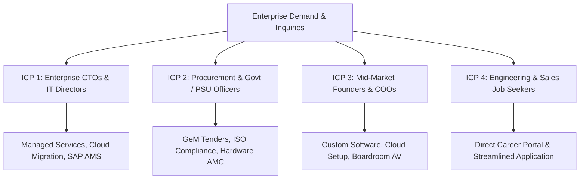
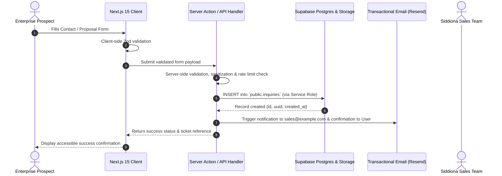
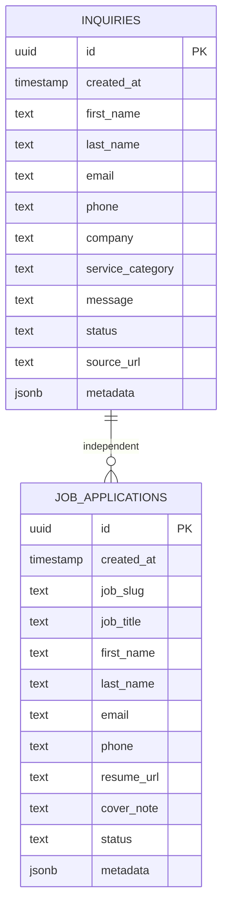
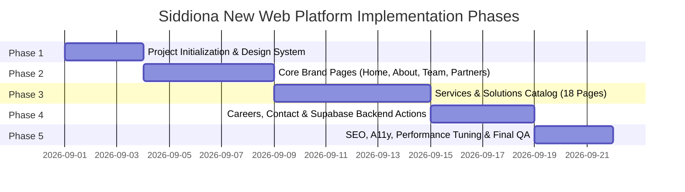

# Comprehensive Website Analysis & Technical Specification

## Current Solutions Update (October 5, 2026)

The discovery audit below describes the earlier website and is retained as historical context. The implemented Next.js portfolio now comprises Backup & Disaster Recovery, Data Center Migration & Virtualization, Smart Classrooms & AV Systems, and Annual Maintenance Contract Services.

Each dedicated page uses the shared full-height animated Solutions hero without a hero image or duplicate contact CTA. The core-capability rows now use relevant white outline icons in colored circles instead of numbers, following the approved reference. Existing descriptions, headings, dividers, and responsive row structure remain intact; delivery stages still use sequence numbers. No new claims, assets, dependencies, or behavioral changes were introduced.

The icon refinement passed lint, production build including TypeScript, and whitespace checks. Generated production HTML contains five capability icons and badges on each page. Live visual browser checks and production deployment were not performed for this refinement.

**Project:** Siddiona Technologies Services Pvt. Ltd.
(`https://siddiona.com/`)\
**Document Version:** 1.0.0\
**Phase:** Discovery, Architecture & Strategy\
**Target Stack:** Next.js 15 (App Router, React 19, TypeScript), Tailwind CSS
v4, Motion, Supabase (Postgres, RLS, Storage)

---

## 1. Executive Summary

Siddiona Technologies Services Pvt. Ltd. (STSPL), founded in 2021 and
headquartered in New Delhi, is an enterprise technology solutions
provider, system integrator, and IT services consultancy. The company delivers
end-to-end technology infrastructure, managed IT services, cloud migration,
enterprise software licensing, ERP/SAP consulting, custom application
development, and physical security/smart automation systems for corporate
enterprises, public sector undertakings (PSUs), and government organizations
across India and global markets.

The current live digital presence (`https://siddiona.com/`) runs on
WordPress with Elementor and the Quiety theme. While it contains substantial
content and catalog entries, it suffers from critical architectural,
performance, and UX bottlenecks typical of legacy monolithic template setups:

- High bundle weight and redundant CSS/JS from multi-layer page builders and
  unused e-commerce plugins.
- Broken responsive breakpoints, nested invalid markup
  (`<h1><h2>...</h2></h1>`), and generic template placeholder copy.
- Unstructured lead generation and job intake channels vulnerable to spam and
  lack automated data pipelines.
- Absence of modern search engine optimization (dynamic OpenGraph, JSON-LD
  structured data) and accessibility compliance (WCAG 2.1 AA).

This document delivers an exhaustive 360-degree audit of the live website,
captures all business logic, services, solutions, and leadership data, and
defines the blueprint for a high-performance, enterprise-grade Next.js 15
application paired with Supabase.

---

## 2. Business Understanding & Strategic Identity

### 2.1 Corporate Identity & Founding

- **Legal Entity:** Siddiona Technologies Services Pvt. Ltd. (STSPL)
- **Year Established:** 2021
- **Headquarters / Operations Center:** Demo Business Park, New Delhi,
  India
- **Core Positioning:** "Transforming Businesses Through Agile, Scalable, and
  High-Performance IT Solutions."
- **Key Milestones / Metrics:**
  - **3+ Years** in enterprise operations
  - **100+** Active enterprise client users / accounts
  - **3M+** Annualized revenue scale
  - **15+** Core certified technology specialists & delivery engineers
  - **92%** Client retention rate (4+ years relationship lifecycle)
  - **90%** Team & talent retention rate
  - **80%** Client satisfaction index

### 2.2 Operational Pillars & Service Verticals

Siddiona operates across three major commercial capabilities:

1. **IT Services & Strategic Consulting:** Managed infrastructure (NOC 24/7/365,
   AMC, Facility Management), Cloud solutions (AWS, Azure, GCP, M365,
   Workspace), Custom Application Engineering, and Enterprise SAP ERP Consulting
   (S/4HANA migration, AMS).
2. **Enterprise Software & Licensing Solutions:** Authorized licensing and
   compliance lifecycle management for Microsoft, AWS, Google Cloud, Adobe
   Creative/Document Cloud, VMware virtualization, and enterprise security
   suites.
3. **Smart Infrastructure & ELV/Automation Solutions:** System integration
   covering Building Management Systems (BMS/SCADA), IP Surveillance (CCTV),
   Access Control & Biometrics, Fire Detection & Alarms, Telecom/VoIP, Video
   Conferencing (Boardroom AV), Water Leak Detection, and Data Center UPS/Power
   backup.

### 2.3 Strategic Partnerships & Vendor Authorizations

- **Microsoft:** Authorized Reseller & Cloud Solution Partner
- **Amazon Web Services (AWS):** AWS Consulting Partner
- **Google Cloud:** Authorized Reseller Partner (GCP & Google Workspace)
- **Adobe:** Authorized Reseller (Creative Cloud, Document Cloud, Experience
  Cloud)
- **VMware:** VMware Professional Solution Provider

### 2.4 Certifications & Quality Compliance

- **ISO 9001:2015** – Quality Management System (QMS)
- **ISO 27001:2022** – Information Security Management System (ISMS)
- **ISO 20000-1:2018** – IT Service Management System (ITSMS)
- **ISO 45001:2018** – Occupational Health & Safety Management System (OHSMS)
- **ISO 14001:2015** – Environmental Management System (EMS)

---

## 3. Target Audience & Ideal Customer Profiles (ICPs)

The website must cater directly to sophisticated enterprise stakeholders who
prioritize reliability, engineering competence, compliance credentials, and
low-friction communication over buzzwords.



### 3.1 ICP Breakdown

1. **Enterprise CTOs, VPs of Infrastructure & IT Directors:**
   - _Pain Points:_ High downtime, unmanaged multicloud costs, legacy tech debt,
     fragmented IT vendors, security vulnerabilities.
   - _Requirements:_ SLA guarantees (99.9%+), 24/7/365 NOC support, ISO 27001
     verified data protection, proven migration methodologies.
2. **Public Sector & PSU Procurement Managers (GeM Ecosystem):**
   - _Pain Points:_ Strict compliance mandates, tender specification matching,
     vendor solvency, hardware warranty governance.
   - _Requirements:_ Transparent OEM authorizations (Microsoft, AWS, VMware),
     ISO certifications, structured AMC terms.
3. **Mid-Market Founders, COOs & Operations Heads:**
   - _Pain Points:_ Rapid growth outstripping internal IT capacity, need for
     office automation and unified networking, software license overspending.
   - _Requirements:_ Turnkey solutions (from cabling and boardroom AV to cloud
     productivity tools), single-point account manager.
4. **Technology Talent & Enterprise Sales Candidates:**
   - _Pain Points:_ Opaque hiring channels, cumbersome external application
     portals.
   - _Requirements:_ Clean job listings, clear role requirements, direct
     frictionless resume intake.

---

## 4. Complete Sitemap & Information Architecture

The website hierarchy is structured to provide intuitive discovery across all 6
core service domains and 12 infrastructure/smart building solutions.

```
/
├── /about/ (Company Overview, Vision, Story, Metrics, Philosophy)
├── /our-team/ (Executive Leadership Profiles & Governance)
├── /service/ (Services Catalog Hub)
│   ├── /service/managed-it-service/ (Infrastructure AMC, FMS, 24/7 NOC, Master MSP)
│   ├── /service/it-consultancy-service/ (IT Assessment, Architecture, Project Management)
│   ├── /service/enterprise-solution/ (Data Center, Warranty Management, Outsourcing)
│   ├── /service/application-service/ (Custom Dev, Mobile/Web, Modernization, EAI)
│   ├── /service/cloud-solutions/ (Cloud Infra AWS/Azure/GCP, M365/Google Workspace)
│   └── /service/sap-consulting-services/ (S/4HANA Migration, SAP AMS, Implementation)
├── /solutions/ (Solutions & Infrastructure Directory)
│   ├── /solutions/room-automation/ (Smart Office & Meeting Room Control)
│   ├── /solutions/surveillance-camera/ (Enterprise IP CCTV & Video Analytics)
│   ├── /solutions/public-address-system/ (PA & Commercial Audio Distribution)
│   ├── /solutions/access-control-system/ (Biometric & RFID Access Security)
│   ├── /solutions/water-detection-system/ (Server Room & Facility Water Leak Detection)
│   ├── /solutions/data-voice-networking/ (Structured Cabling, Switching & Routing)
│   ├── /solutions/telecom-network/ (VoIP, IP-PBX & Unified Communications)
│   ├── /solutions/video-conferencing/ (Boardroom AV, Zoom/Teams Room Systems)
│   ├── /solutions/fire-detection/ (Addressable Fire Alarms & Smoke Detection)
│   ├── /solutions/rodent-repellent/ (Data Center Ultrasonic Rodent Repellers)
│   ├── /solutions/bms-scada/ (Building Management Systems & SCADA Automation)
│   └── /solutions/ups/ (Online Enterprise UPS & Power Backup Systems)
├── /service/why-siddiona-technologies/ (Value Propositions, 6 Core Differentiators)
├── /partnership/ (Authorized OEM Partners & ISO Certifications)
├── /career/ (Hiring Portal, Culture, Active Openings Directory)
│   └── /career/[slug]/ (Detailed Job Description & Resume Upload Application)
├── /contact/ (Multi-channel Inquiry, Interactive Form, Office Location & WhatsApp)
├── /privacy-policy/ (Data Protection & Privacy Terms)
└── /terms-of-service/ (Service Terms & Agreements)
```

---

## 5. Page-by-Page Detailed Breakdown

### 5.1 Homepage (`/`)

- **Purpose:** Establish brand authority, deliver immediate clarity on
  capability scope, build trust with OEM partner badges and ISO certifications,
  and direct visitors into high-intent conversion paths.
- **Key Sections:**
  1. **Hero Section:** High-impact dynamic hero with refined typography, value
     proposition ("Enterprise IT Solutions, Cloud Transformation & Smart
     Infrastructure Integration"), dual CTAs ("Explore Services", "Schedule
     Consultation"), and key performance metrics counter ribbon.
  2. **Company Overview ("The Beginning"):** Condensed introduction to
     Siddiona's trajectory since 2021, mission-driven ethos, and delivery
     excellence.
  3. **Interactive Services Matrix:** Tabbed or modular interactive grid
     presenting the 6 core pillars (Managed IT, IT Consulting, Enterprise
     Solutions, Application Services, Cloud Solutions, SAP Consulting).
  4. **Why Choose Siddiona (Key Value Props):** 6 key pillars with double-bezel
     cards (24/7/365 NOC, Guaranteed SLA Uptime, Dedicated Relationship Manager,
     End-to-End Delivery, Certified Engineers, Zero-Downtime Migration).
  5. **Solutions & ELV Capabilities Showcase:** Interactive showcase of smart
     building, data center, and security infrastructure capabilities.
  6. **Strategic Partners & Authorizations Bar:** High-resolution vector logos
     for Microsoft, AWS, Google Cloud, Adobe, and VMware.
  7. **Enterprise Certifications Grid:** Displaying ISO 9001, ISO 27001, ISO
     20000-1, ISO 45001, and ISO 14001 badges with verification details.
  8. **Client Testimonials & Impact Metrics:** Curated enterprise client case
     highlights and verified feedback.
  9. **Bottom Conversion CTA:** High-contrast, premium dark CTA banner driving
     direct quote requests.

### 5.2 About Us (`/about/`)

- **Purpose:** Articulate company history, leadership vision, operational
  values, and operational scale.
- **Key Sections:**
  1. **Page Header:** Clean breadcrumb with contextual typography.
  2. **Narrative & Vision:** The founding story, client-centric delivery
     philosophy, and evolution into an integrated technology powerhouse.
  3. **Operational Metrics Grid:** Live counters displaying 100+ Active
     Accounts, 3M+ Annual Scale, 15+ Core Specialists, 3+ Years in Business.
  4. **Core Values & Culture:** Innovation, Quality Commitment, Information
     Security, and Customer First.
  5. **Integrated Management System:** Deep dive into how ISO standards govern
     day-to-day service delivery and client SLA management.

### 5.3 Leadership Team (`/our-team/`)

- **Purpose:** Humanize the brand, build executive trust, and demonstrate
  specialized domain leadership.
- **Profiles & Governance:**
  1. **Mamta Kargeti** – Director of Operations & Sales (Leading operational
     excellence, client relations, and delivery scalability).
  2. **Saumya Mohanty** – Director of Sales & Marketing (Leading commercial
     strategy, strategic enterprise partnerships, and brand expansion).
  3. **Dushyant Nagar** – Director of Legal & Operations (Governing compliance,
     commercial agreements, governance, and organizational legal frameworks).
- **Section Design:** Modern executive cards with high-resolution portraits,
  professional biographies, core focus areas, and LinkedIn profile links.

### 5.4 Why Siddiona Technologies (`/service/why-siddiona-technologies/`)

- **Purpose:** Quantitative and qualitative differentiation page addressing
  procurement committees and technical evaluators.
- **6 Key Differentiators:**
  1. _Comprehensive Technology Expertise:_ Holistic coverage from physical data
     center layer up to cloud software.
  2. _Industry-Specific Custom Solutions:_ Tailored architectures for finance,
     manufacturing, healthcare, and public sector.
  3. _Agile & Scalable Delivery Model:_ Modular engagement frameworks adapting
     to project size.
  4. _Innovation & Future-Ready Approach:_ Continuous adoption of modern
     cloud-native, AI-driven, and automated workflows.
  5. _Proven Track Record & Client Trust:_ 92% retention rate across multi-year
     enterprise contracts.
  6. _Long-Term Partnership Mentality:_ Dedicated account management and
     proactive lifecycle support.
- **Quantitative Performance Stats:** 80% custom delivery index, 90% engineer
  retention, 40% operational cost optimization.

### 5.5 Partnerships & Certifications (`/partnership/`)

- **Purpose:** Showcase OEM credentials and formal ISO compliance badges to pass
  enterprise vendor onboarding checks.
- **Sections:**
  1. **Strategic OEM Partnerships:** In-depth descriptions and authorized
     partner badges for Microsoft Reseller Partner, AWS Consulting Partner,
     Google Cloud Reseller, Adobe Partner, and VMware Professional Solution
     Provider.
  2. **Compliance & ISO Standards:** Verified breakdowns for ISO 9001 (Quality),
     ISO 27001 (Information Security), ISO 20000-1 (ITSM), ISO 45001 (Health &
     Safety), and ISO 14001 (Environmental).

### 5.6 Service Catalog Pages (`/service/*`)

Each of the 6 core service pages follows a consistent, high-converting layout
structure:

- **Hero & Value Summary:** Clear problem-solution framing.
- **Core Capability Modules:** 6 detailed sub-service cards with iconography,
  bullet points, and practical business use cases.
- **Why Choose Siddiona for this Domain:** Domain-specific differentiators (e.g.
  certified SAP consultants, AWS-certified architects).
- **FAQ Accordion:** Addressing common pre-sales queries (migration timelines,
  pricing models, SLA terms, support escalation).
- **Direct Proposal Request CTA:** Context-aware form jump or booking trigger.

#### Individual Service Scope:

1. **Managed IT Services (`/service/managed-it-service/`):**
   - Annual Maintenance Contract (AMC) for IT Infra
   - IT Facility Management Services (FMS on-site engineers)
   - 24/7/365 Remote NOC Support & Infrastructure Monitoring
   - Hybrid IT Co-Managed Services
   - Master MSP / White-Label IT Management
   - On-Demand Professional IT Engineering
2. **IT Consultancy Services (`/service/it-consultancy-service/`):**
   - Strategic Technology Consulting & Roadmapping
   - Service Oriented Architecture (SOA) & System Integration Consulting
   - Enterprise Project Management Consulting
   - IT Infrastructure Assessment & Optimization
   - Cloud Readiness & Multi-Cloud Architecture Consulting
   - IT Security & Vulnerability Assessment
3. **Enterprise Solutions (`/service/enterprise-solution/`):**
   - Enterprise IT Infrastructure Solutions
   - Modern Data Center Design, Deployment & Hyperconverged Infrastructure
   - Campus & Enterprise Network Infrastructure (Routing/Switching/SD-WAN)
   - Software Licensing Governance & Audit Compliance
   - Multi-Vendor Hardware Warranty Management
   - Strategic IT Staffing & Resource Outsourcing
4. **Application Services (`/service/application-service/`):**
   - Custom Enterprise Application Development (Web, Mobile, Microservices)
   - Cross-Platform Mobile & Web Apps (React Native, iOS, Android, Progressive
     Web Apps)
   - Enterprise Application Integration (EAI, APIs, Middleware, EDI)
   - Legacy Application Modernization & Cloud Refactoring
   - End-to-End Application Management & Support (L1/L2/L3)
   - Dedicated Engineering Staff Augmentation
5. **Cloud Solutions (`/service/cloud-solutions/`):**
   - Enterprise Cloud Infrastructure Deployment (AWS, Microsoft Azure, Google
     Cloud Platform)
   - Business Cloud Productivity & Email Solutions (Microsoft 365, Google
     Workspace)
   - Zero-Downtime Cloud Migration & Architecture Modernization
   - Automated Backup, Disaster Recovery as a Service (DRaaS), and Business
     Continuity
   - Cloud Security Posture Management & Compliance Governance
   - Managed Multi-Cloud Operations & Cost Optimization (FinOps)
6. **SAP Consultancy Services (`/service/sap-consulting-services/`):**
   - SAP ERP Strategy, Planning & Readiness Evaluation
   - SAP Implementation, Customization & Multi-Location Rollouts
   - SAP S/4HANA Cloud & On-Premise Migration
   - SAP Application Management Services (SAP AMS 24/7 Support)
   - SAP Upgrades, Enhancement Packs & Performance Tuning
   - SAP Third-Party Integration & Custom ABAP/Fiori Development

### 5.7 Solutions Directory (`/solutions/*`)

Covers the 12 specialized smart infrastructure, low-voltage (ELV), and physical
IT engineering domains:

1. **Room Automation (`/solutions/room-automation/`):** Smart boardroom
   automation, lighting, motorized blinds, sensor integration, Crestron/Extron
   control.
2. **Surveillance Camera Systems (`/solutions/surveillance-camera/`):**
   Enterprise IP CCTV, AI-powered video analytics, ANPR, thermal imaging, NVR
   storage arrays.
3. **Public Address Systems (`/solutions/public-address-system/`):** IP-based
   paging, commercial sound distribution, emergency voice evacuation systems.
4. **Access Control Systems (`/solutions/access-control-system/`):** Biometric
   fingerprint, facial recognition, RFID contactless cards, turnstiles, visitor
   management.
5. **Water Detection Systems (`/solutions/water-detection-system/`):** Server
   room and data center zone-based water leak detection cables, sensor panels,
   and SMS alert modules.
6. **Data & Voice Networking (`/solutions/data-voice-networking/`):** Structured
   Cat6A/Fiber optic cabling, patch panels, server racks, managed switches,
   enterprise Wi-Fi 6/7.
7. **Telecommunication Networks (`/solutions/telecom-network/`):** Enterprise
   IP-PBX systems, SIP trunking, unified communication systems, call center
   headsets and gateways.
8. **Video Conferencing Solutions (`/solutions/video-conferencing/`):**
   Microsoft Teams Rooms, Zoom Rooms, Polycom/Logitech hardware, dual-display
   setups, wireless presentation.
9. **Fire Detection & Alarm Systems (`/solutions/fire-detection/`):**
   Addressable fire alarm panels, optical smoke detectors, heat detectors,
   manual call points, fire suppression triggers.
10. **Rodent Repellent Systems (`/solutions/rodent-repellent/`):**
    High-frequency ultrasonic rodent deterrent systems for false floors, false
    ceilings, and server rooms.
11. **BMS & SCADA Automation (`/solutions/bms-scada/`):** Building Management
    Systems integrating HVAC, lighting, energy meters, UPS, DG sets, and
    environmental sensors into central SCADA dashboards.
12. **Uninterruptible Power Supply (UPS) (`/solutions/ups/`):** Online
    double-conversion industrial UPS systems, redundant battery banks, power
    distribution units (PDUs).

### 5.8 Career Portal & Job Postings (`/career/` & `/career/[slug]/`)

- **Hub Page (`/career/`):**
  - Employer value proposition ("Build Your Career at Siddiona Technologies").
  - Work culture, mentorship programs, training certifications, competitive
    compensation, and health benefits.
  - Active positions grid with category filtering (Engineering, Corporate Sales,
    IT Support, Project Management).
- **Job Detail Page (`/career/[slug]/`):**
  - Role title, department, employment type (Full-Time / On-Site / Hybrid),
    location (Demo Business Park), experience level.
  - Detailed responsibilities, mandatory qualifications, and preferred
    certifications.
  - **Frictionless Application Form:** First Name, Last Name, Email, Phone,
    LinkedIn/Portfolio URL, Experience Level, Expected CTC, Cover Note, and
    Resume File Attachment (`.pdf`, `.docx` up to 10MB).
  - Secure upload directly to Supabase Storage with anti-virus/MIME validation.

### 5.9 Contact Us (`/contact/`)

- **Multi-Channel Contact Options:**
  - Direct Phone: `+91-00000-00000` / `+91-11-XXXXXXXX`
  - Direct HR Email: `hr@example.com`
  - Direct Technical Email: `tech@example.com`
  - Direct WhatsApp Chat: Instant click-to-chat integration with prefilled
    inquiry message
  - Physical Office Address: Demo Business Park, New Delhi, India
- **Interactive Enterprise Inquiry Form:**
  - Fields: First Name, Last Name, Work Email, Phone Number, Company Name,
    Service Vertical (Dropdown), Estimated Budget / Timeline, Project
    Description.
  - Security: Honeypot field, server-side validation via Zod, rate limiting, and
    instant automated email notification.

---

## 6. Functional Requirements & Data Workflows



### 6.1 Core Functional Modules

1. **Lead & RFP Inquiry Intake:**
   - Client and server-side validation via `zod`.
   - Persistence in Supabase `inquiries` table with status tracking (`new`,
     `contacted`, `qualified`, `closed`).
   - Transactional email dispatch to the sales team with full lead metadata and
     source attribution (UTM parameters).
2. **Career & Resume Intake:**
   - Multi-part file upload with client-side format and file-size guardrails.
   - Upload resume binary directly to private Supabase Storage bucket
     (`resumes/`).
   - Write applicant details to `job_applications` table with reference to the
     resume file path.
   - Admin access restricted via Row Level Security (RLS) to authenticated team
     members only.
3. **Interactive Search & Solutions Filter:**
   - Instant client-side fuzzy search across all services and 12 solution pages.
   - Category filtering on the Career page.
4. **WhatsApp Direct Connect:**
   - Floating and contextual action buttons initiating pre-populated WhatsApp
     conversations tailored to the page the user is viewing (e.g. "Hi Siddiona
     team, I'm interested in Managed IT Services...").

---

## 7. UI/UX Design System & Anti-Slop Principles

To ensure the new Siddiona web application looks like a top-tier global
enterprise consultancy rather than a generic template, the design system adheres
strictly to the installed frontend skills (`design-taste-frontend`,
`high-end-visual-design`, `apple-design`):

### 7.1 Color Architecture & Palette

- **Deep Foundation Surface:** Rich, deep midnight navy/slate
  (`hsl(222, 47%, 11%)` / `#0B132B`) avoiding muddy pure blacks.
- **Surface Elevators:**
  - Card Surface 1: `rgba(255, 255, 255, 0.03)` with
    `1px solid rgba(255, 255, 255, 0.08)`
  - Card Surface 2 (Hover/Active): `rgba(255, 255, 255, 0.06)` with double-bezel
    rim highlight `rgba(255, 255, 255, 0.15)`
- **Primary Brand Accents:**
  - Electric Indigo: `hsl(238, 84%, 67%)` / `#5B6EF5`
  - Cyber Cyan: `hsl(188, 86%, 53%)` / `#1AD2EB`
  - High-Efficiency Emerald (Status/Success): `hsl(158, 64%, 52%)` / `#2DD4BF`
- **Text & Contrast Hierarchy:**
  - Primary Text: `hsl(210, 40%, 98%)` (High legibility, passes WCAG AAA)
  - Secondary Text: `hsl(215, 20%, 75%)`
  - Muted/Caption Text: `hsl(215, 16%, 55%)`

### 7.2 Typography Pairing & Hierarchy

- **Primary Display & Headings:** `Plus Jakarta Sans` or `Outfit` (Geometric,
  crisp, modern tech authority).
- **Body & Interface:** `Inter` (Optimized for readability across all screen
  densities, optical sizing enabled).
- **Code / Technical Specifications:** `JetBrains Mono` or `Fira Code`.
- **Rules Enforced:**
  - No orphaned words on display titles (`text-wrap: balance`).
  - Strict line-height scales (`leading-tight` for display headings,
    `leading-relaxed` for editorial body copy).

### 7.3 Spatial System & Micro-Interactions

- **Spatial Scale:** 4px baseline rhythm with 8-point grid tokens (`gap-4`,
  `gap-6`, `gap-8`, `gap-12`, `py-16`, `py-24`).
- **Micro-Interactions & Motion:**
  - Subtle spring-based hover elevations (using `framer-motion` / Motion spring
    presets).
  - Button-in-button nested icons with micro-translate transitions on hover
    (`group-hover:translate-x-1`).
  - Double-bezel card borders creating a physical glass-morphic depth without
    overwhelming the eye.
  - Smooth page transitions and interruptible dropdown menus.

---

## 8. Responsive & Viewport Requirements

1. **True Viewport Stability:**
   - Layout containers use modern dynamic viewport units (`min-h-[100dvh]`) to
     prevent mobile browser address bar layout jumps.
2. **Breakpoints Matrix:**
   - **Mobile (320px – 639px):** Single-column stacked layouts, accessible
     full-screen sliding navigation drawer, touch-friendly tap targets (minimum
     44x44px), sticky bottom quick-contact action bar.
   - **Tablet (640px – 1023px):** 2-column balanced grid, horizontal scroll tabs
     for dense sub-services.
   - **Desktop (1024px – 1439px):** Full multi-column navigation with nested
     flyout solution menus, asymmetric feature cards.
   - **Ultra-Wide (1440px+):** Constrained maximum readable container width
     (`max-w-7xl` / 1280px or `max-w-screen-2xl` / 1440px) with centered
     alignment.

---

## 9. SEO & Metadata Strategy

1. **Semantic Structure:**
   - Strictly one `<h1>` per page representing the core topic.
   - Hierarchical `<h2>`, `<h3>` heading structure without skipped levels.
2. **Metadata & OpenGraph:**
   - Dynamic Next.js App Router `generateMetadata` implementation for all
     dynamic routes (`/career/[slug]`, `/service/[slug]`, `/solutions/[slug]`).
   - OpenGraph image generation (`opengraph-image.tsx`) with dynamic branding
     and page titles.
   - Twitter Card meta tags (`summary_large_image`).
   - Canonical URLs configured globally via Next.js metadata base URL.
3. **Structured Data (JSON-LD):**
   - **Organization Schema:** Company name, logo, founding date, address, phone,
     social profiles, and ISO certifications.
   - **Service Schema:** Service type, provider, area served, and service
     output.
   - **JobPosting Schema:** On all individual career pages with job title,
     datePosted, validThrough, employmentType, hiringOrganization, and
     jobLocation for Google Jobs indexing.
   - **BreadcrumbList Schema:** On all nested service and solution pages.

---

## 10. Accessibility (A11y) Requirements

1. **Compliance Target:** WCAG 2.1 Level AA across all pages and interactive
   components.
2. **Color Contrast:** All text elements meet or exceed 4.5:1 for normal text
   and 3:1 for large text against their respective background surfaces.
3. **Keyboard Navigation:**
   - Visible, high-contrast focus rings
     (`focus-visible:ring-2 focus-visible:ring-primary focus-visible:outline-none`).
   - Skip to main content link (`SkipToContent`) as the first tabbable element.
   - Full keyboard accessibility for navigation dropdowns, modals, and
     accordions with `Escape` key listeners.
4. **Screen Reader Optimization:**
   - Descriptive `aria-label` attributes on all icon-only buttons.
   - `aria-expanded` and `aria-controls` on mobile navigation toggles and FAQ
     accordions.
   - Form inputs paired with explicit `<label>` tags and `aria-describedby` for
     validation errors.

---

## 11. Performance Targets & Core Web Vitals

1. **Target Metrics:**
   - **Largest Contentful Paint (LCP):** < 1.2s on desktop, < 2.0s on 4G mobile.
   - **Cumulative Layout Shift (CLS):** 0.000 (Zero layout shifts).
   - **Interaction to Next Paint (INP):** < 100ms.
   - **Lighthouse Scores:** 95+ across Performance, Accessibility, Best
     Practices, and SEO.
2. **Optimization Techniques:**
   - Next.js `next/image` with WebP/AVIF modern formats, defined `sizes`, and
     responsive `srcset`.
   - Critical fonts loaded locally via `next/font/google` with `display: swap`
     and zero external render-blocking font stylesheet requests.
   - Code-splitting with dynamic imports for heavy non-critical components (e.g.
     interactive 3D/canvas or video embeds).
   - Static Site Generation (SSG) / Incremental Static Regeneration (ISR) for
     all core informational pages.

---

## 12. Supabase Backend Architecture & Schema Specifications

The Supabase integration provides a secure, relational persistence layer for
lead management, job applications, resume file storage, and optional case study
CMS data.



### 12.1 Database Schema (PostgreSQL DDL)

```sql
-- Enable UUID extension
create extension if not exists "uuid-ossp";

-- 1. Table: inquiries (Lead generation & RFPs)
create table if not exists public.inquiries (
  id uuid primary key default uuid_generate_v4(),
  created_at timestamp with time zone default timezone('utc'::text, now()) not null,
  first_name text not null,
  last_name text not null,
  email text not null,
  phone text,
  company text,
  service_category text,
  message text not null,
  status text default 'new' not null check (status in ('new', 'in_review', 'contacted', 'closed')),
  source_url text,
  metadata jsonb default '{}'::jsonb
);

-- Indexes for inquiries
create index if not exists inquiries_created_at_idx on public.inquiries (created_at desc);
create index if not exists inquiries_status_idx on public.inquiries (status);
create index if not exists inquiries_email_idx on public.inquiries (email);

-- Enable RLS for inquiries
alter table public.inquiries enable row level security;

-- Inquiries RLS Policies:
-- Anonymous clients can only INSERT (via server action / API with service role or direct anon with rate limits)
create policy "Allow anonymous submissions to inquiries"
  on public.inquiries
  for insert
  to anon, authenticated
  with check (true);

-- Only authenticated team members can view inquiries
create policy "Allow authenticated staff to read inquiries"
  on public.inquiries
  for select
  to authenticated
  using (true);

-- Only authenticated team members can update inquiry status
create policy "Allow authenticated staff to update inquiries"
  on public.inquiries
  for update
  to authenticated
  using (true);


-- 2. Table: job_applications (Careers & Candidate applications)
create table if not exists public.job_applications (
  id uuid primary key default uuid_generate_v4(),
  created_at timestamp with time zone default timezone('utc'::text, now()) not null,
  job_slug text not null,
  job_title text not null,
  first_name text not null,
  last_name text not null,
  email text not null,
  phone text not null,
  resume_url text not null,
  cover_note text,
  status text default 'submitted' not null check (status in ('submitted', 'screening', 'interview', 'offered', 'rejected')),
  metadata jsonb default '{}'::jsonb
);

-- Indexes for job_applications
create index if not exists job_applications_created_at_idx on public.job_applications (created_at desc);
create index if not exists job_applications_job_slug_idx on public.job_applications (job_slug);
create index if not exists job_applications_status_idx on public.job_applications (status);

-- Enable RLS for job_applications
alter table public.job_applications enable row level security;

-- Job Applications RLS Policies:
create policy "Allow anonymous candidate submissions"
  on public.job_applications
  for insert
  to anon, authenticated
  with check (true);

create policy "Allow authenticated staff to view applications"
  on public.job_applications
  for select
  to authenticated
  using (true);

create policy "Allow authenticated staff to update applications"
  on public.job_applications
  for update
  to authenticated
  using (true);
```

### 12.2 Supabase Storage Configuration (`resumes` Bucket)

- **Bucket Name:** `resumes` (Private bucket)
- **Allowed MIME Types:** `application/pdf`, `application/msword`,
  `application/vnd.openxmlformats-officedocument.wordprocessingml.document`
- **Max File Size:** `10485760` (10 MB)
- **Storage RLS Policies:**
  - `anon` / unauthenticated users can upload files into the bucket via secure
    Server Actions.
  - Public reads are disabled. Only authenticated HR/Admin users or signed URLs
    generated server-side can download resume binaries.

---

## 13. Recommended Technical Stack & Directory Structure

### 13.1 Technology Stack Selection

- **Framework:** Next.js 15+ (App Router, Server Components, Server Actions)
- **Runtime / Core:** React 19, TypeScript (Strict Mode)
- **Styling:** Tailwind CSS v4 (CSS variables, modern color-mix, zero-runtime
  overhead)
- **Animation & Motion:** `framer-motion` / Motion (GPU-accelerated hardware
  transforms)
- **Icons:** `lucide-react` (High-legibility, scalable SVG icon set)
- **Validation:** `zod` (Unified client & server type validation)
- **Database & Auth:** Supabase (`@supabase/ssr`, `@supabase/supabase-js`)
- **Transactional Email:** Resend or SendGrid API integration

### 13.2 Project Directory Architecture

```
siddiona.com/
├── docs/
│   └── website-analysis.md             # This comprehensive architecture document
├── public/
│   ├── brand/                          # High-res vector SVGs (Siddiona logo, icon mark)
│   ├── partners/                       # Vector partner logos (Microsoft, AWS, GCP, Adobe, VMware)
│   ├── certs/                          # Vector ISO compliance badges (9001, 27001, 20000, 45001, 14001)
│   └── images/                         # Art-directed WebP imagery for services & solutions
├── src/
│   ├── app/
│   │   ├── layout.tsx                  # Root layout (Metadata, Google Font injection, Header, Footer)
│   │   ├── page.tsx                    # Homepage
│   │   ├── about/page.tsx              # About Us page
│   │   ├── our-team/page.tsx           # Leadership Team page
│   │   ├── partnership/page.tsx        # Partnerships & Certifications page
│   │   ├── service/
│   │   │   ├── page.tsx                # Services Catalog Directory
│   │   │   ├── managed-it-service/page.tsx
│   │   │   ├── it-consultancy-service/page.tsx
│   │   │   ├── enterprise-solution/page.tsx
│   │   │   ├── application-service/page.tsx
│   │   │   ├── cloud-solutions/page.tsx
│   │   │   ├── sap-consulting-services/page.tsx
│   │   │   └── why-siddiona-technologies/page.tsx
│   │   ├── solutions/
│   │   │   ├── page.tsx                # Solutions Overview Hub
│   │   │   ├── [slug]/page.tsx         # Dynamic Solution Details (Room Automation, CCTV, BMS, etc.)
│   │   ├── career/
│   │   │   ├── page.tsx                # Career Hub & Active Openings
│   │   │   └── [slug]/page.tsx         # Job Post & Application Form
│   │   ├── contact/page.tsx            # Contact Us & Interactive Form
│   │   ├── privacy-policy/page.tsx     # Privacy Policy
│   │   ├── terms-of-service/page.tsx   # Terms of Service
│   │   ├── sitemap.ts                  # Dynamic XML Sitemap generator
│   │   ├── robots.ts                   # Search engine crawling rules
│   │   └── actions/                    # Next.js Server Actions
│   │       ├── submit-inquiry.ts       # Contact form action (Zod + Supabase + Email)
│   │       └── submit-application.ts   # Job application action (Zod + Storage + DB)
│   ├── components/
│   │   ├── layout/                     # Header, StickyNav, MobileDrawer, Footer
│   │   ├── ui/                         # Buttons, Cards, Inputs, Accordions, Modal, Badges
│   │   ├── sections/                   # Hero, ServicesGrid, WhyChooseUs, PartnerWall, IsoGrid
│   │   ├── forms/                      # ContactForm, JobApplicationForm, NewsletterForm
│   │   └── motion/                     # FadeIn, StaggerContainer, SlideIn wrappers
│   ├── lib/
│   │   ├── supabase/                   # Supabase client & server helper utilities
│   │   ├── validations/                # Zod schemas for forms
│   │   ├── constants/                  # Services data, Solutions data, Job listings, FAQs
│   │   └── utils.ts                    # cn() class utility, formatters
│   └── types/                          # TypeScript definitions (Service, Solution, Job, Inquiry)
├── tailwind.config.ts / globals.css    # Tailwind CSS v4 design tokens and utilities
└── tsconfig.json                       # Strict TypeScript configuration
```

---

## 14. Recommended Implementation Roadmap & Phasing

To execute the build cleanly from scratch without technical debt, the project
should proceed through 5 structured phases:



### Phase 1: Project Setup, Asset Pipeline & Design System Foundation

- Initialize Next.js 15 App Router project with TypeScript and Tailwind CSS v4.
- Configure Google Fonts (`Plus Jakarta Sans` + `Inter`), CSS variable color
  tokens, and spatial rules.
- Build the core component design library (Buttons, Double-bezel Cards, Section
  Headings, Accordions, Form Inputs, Badges).
- Implement global navigation (`Header`, `StickyNav`, `MobileDrawer`) and
  comprehensive `Footer`.

### Phase 2: Core Informational & Authority Pages

- Implement high-converting **Homepage (`/`)** with hero metrics, interactive
  service switcher, partner badges, and ISO trust grid.
- Implement **About Us (`/about/`)**, **Leadership Team (`/our-team/`)**, **Why
  Siddiona (`/service/why-siddiona-technologies/`)**, and **Partnerships &
  Certifications (`/partnership/`)**.

### Phase 3: Deep Services Catalog & Solutions Directory

- Implement all 6 specialized **Service Pages** (`/service/managed-it-service`,
  `/service/it-consultancy-service`, `/service/enterprise-solution`,
  `/service/application-service`, `/service/cloud-solutions`,
  `/service/sap-consulting-services`).
- Implement the 12 **Smart Infrastructure & ELV Solution Pages** under
  `/solutions/[slug]` with interactive capability breakdowns and diagrams.

### Phase 4: Career Hub, Contact Engine & Supabase Data Pipelines

- Set up Supabase database schema (`inquiries`, `job_applications`) and private
  `resumes` storage bucket with RLS policies.
- Build the **Career Hub (`/career/`)** and dynamic **Job Detail Pages
  (`/career/[slug]/`)** with direct resume upload handling.
- Build the **Contact Us (`/contact/`)** page with multi-channel routing
  (WhatsApp trigger, interactive form, Google Maps integration).
- Implement Next.js Server Actions with Zod validation, rate limiting, and
  transactional email triggers.

### Phase 5: SEO, Accessibility, Performance Optimization & Launch Verification

- Inject dynamic OpenGraph metadata, Organization/Service/JobPosting JSON-LD
  schemas, XML sitemap, and robots.txt.
- Conduct full WCAG 2.1 AA keyboard and screen reader accessibility validation.
- Execute Core Web Vitals performance tuning (image optimization, dynamic
  imports, zero CLS validation).
- Final production build check and automated verification.

---

_End of Analysis & Specification Document — Ready for Phase 1 Execution upon
User Approval._

---

## Careers route naming - superseded 2026-09-16

The `/career/` and `/career/[slug]/` paths described in this document were
never built under those names. The hiring platform ships at `/careers` and
`/careers/[slug]`, with permanent redirects from the singular form.

The scope also grew beyond what is described here. The implemented feature is
authenticated end to end: Supabase Auth with Google OAuth and email/password,
candidate profiles, an application status timeline, a protected admin console
for job and application management, private resume storage, and transactional
email. Read `docs/architecture.md` under "Careers Platform Architecture" and
`docs/careers-setup.md` for the current state.
